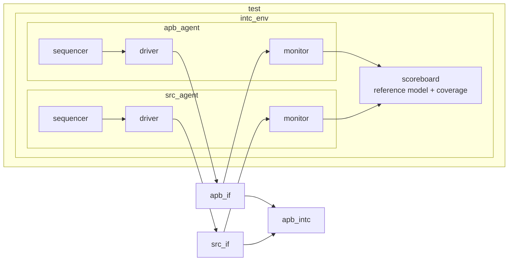

# APB4 Interrupt Controller: UVM + Formal Verification

End to end verification of a small APB4 interrupt controller, using two independent methods on the same RTL:

* **UVM simulation** on Verilator: two agents, a cycle accurate reference model, a self checking scoreboard, functional coverage, and a constrained random regression.
* **Formal verification** with SymbiYosys: an unbounded k induction proof of the design rules, plus cover properties to rule out vacuous passes.

Both flows are then tested against three deliberately injected bugs.

## Results

| Metric | Result |
|---|---|
| Regression | **12/12 runs pass** (`intr_test`, `race_test`, `rand_test` x 10 seeds) |
| Cycles checked against the reference model | **9,395** |
| Functional coverage (merged across runs) | **59/59 bins, 100%** |
| Formal proof | **k induction pass**, 11 properties (P3 to P7 replicated for all 8 sources), depth 20 |
| Formal covers | **6/6 reached** |
| Bug injection | **3/3 bugs caught by simulation and by formal** |

## The design

`rtl/apb_intc.sv` collects 8 interrupt request lines, latches them, masks them, and raises a single `irq_o` to the CPU. The CPU configures and services it over APB4.

| Addr | Register | Access | Behavior |
|---|---|---|---|
| 0x00 | RAW  | RO   | Source levels, registered |
| 0x04 | EN   | RW   | Per source enable |
| 0x08 | MODE | RW   | 1 = rising edge, 0 = level |
| 0x0C | PEND | RW1C | Pending bits (edge mode: write 1 to clear) |
| 0x10 | STAT | RO   | PEND & EN |
| 0x14 | ID   | RO   | Bit 31 valid, bits 4:0 = lowest active source |
| other | n/a | n/a  | `PSLVERR = 1`, no state change |

Behavior:

* **Edge mode:** PEND latches a rising edge and holds it until software clears it. If a rising edge and a clear land on the same clock edge, **the edge wins**, so no interrupt is ever lost.
* **Level mode:** PEND follows the source, one cycle late. Clearing has no effect.
* `irq_o = |(PEND & EN)`, driven only from flops.
* ID reports the **lowest** numbered active source.
* `PSTRB` byte 0 gates writes. No wait states (`PREADY = 1`).
* Design assumptions: sources are synchronous to `PCLK`; one reset at the start.

The state is 4 registers x 8 bits = 32 flops. Yosys synthesis reports 16 flops with enable (EN, MODE) and 16 plain flops (source history, PEND), with no latches.

## Verification plan

| # | Feature | Simulation check | Coverage | Formal |
|---|---|---|---|---|
| F1 | Reset values | Scoreboard | n/a | P1 |
| F2 | EN / MODE writes with PSTRB | Scoreboard (reads) | C1, C7 | P10 |
| F3 | Edge detection | Scoreboard | C2 | P3, P6 |
| F4 | Level mode | Scoreboard | C2 | P7 |
| F5 | W1C clear | Scoreboard | C4 | P4, P5 |
| F6 | Edge vs clear race (edge wins) | Scoreboard | C3 | P3 |
| F7 | `irq_o` | Scoreboard, every cycle | C8 | P2 |
| F8 | ID priority | Scoreboard (reads) | C5, C6 | P8 |
| F9 | Bad address | Scoreboard (`PSLVERR`) | C1 | P9 |
| F10 | Bus protocol, read data | n/a | n/a | P9, P11 |

Every feature has at least one checker and at least one coverage point or proof.

## Testbench architecture



* **apb_agent:** drives and observes APB transfers. Sequences cover configuration, a CPU style interrupt handler (read ID, clear PEND), and fully random traffic.
* **src_agent:** drives the 8 source wires (pulses, levels, bursts) and samples `src` and `irq` every cycle.
* **intc_model:** a plain class that models the 4 registers and the spec rules, advanced one clock edge at a time.
* **intc_scoreboard:** compares `irq_o` every cycle and every APB response (`PRDATA`, `PSLVERR`) against the model.
* **intc_coverage:** 59 functional coverage bins, sampled by the scoreboard.

### Design decisions

* **Race free timing.** Drivers change inputs on the negedge; monitors sample on the posedge.
* **Independent monitors.** Monitors rebuild transactions from the pins only, so a driver bug cannot hide itself.
* **Scoreboard alignment.** Both monitors report on the same posedge in an undefined order. The scoreboard uses the per cycle source sample as its tick and waits 1 ns, so any APB transfer from the same edge has arrived first.
* **Check, then update.** Each sample describes the state going into a clock edge, so the model is compared before it is advanced.
* **Model written from the spec, not the RTL.** For example, the model finds the ID with a forward search, while the RTL uses a reverse loop. A shared bug would need the same mistake written two different ways.
* **Hand rolled coverage.** Verilator 5.049 accepted `covergroup` syntax but reported 0% on a probe that should read 50%, so the same bins are counted with explicit counters.

## Coverage

| # | Coverpoint | Bins | Closed by |
|---|---|---|---|
| C1 | Register access: 6 registers + bad address, x read / write | 14 | `rand_test` |
| C2 | Rising edge per source x mode | 16 | `rand_test` |
| C3 | Edge and clear on the same cycle, per source | 8 | `race_test` |
| C4 | Clear of a bit that was pending, per source | 8 | `rand_test`, `race_test` |
| C5 | ID read value: 0 to 7, or none | 9 | `rand_test` |
| C6 | Two or more sources active at once | 1 | `rand_test` |
| C7 | Write with PSTRB byte 0 off | 1 | `rand_test` |
| C8 | `irq_o` rises and falls | 2 | all tests |

Progression: the directed `intr_test` alone reached **15.3%**. One random seed reached **88.1%**, with the race (C3) at only 1/8, since random timing rarely lines up an edge and a clear. The directed `race_test` closed C3 at 8/8. The merged regression reached **100%**.

## Formal properties

Open source Yosys does not support SVA sequences, so properties are immediate assertions in clocked blocks using `$past`. They live in `formal/apb_intc_props.svh` and are included in the RTL under `` `ifdef FORMAL ``.

| # | Property | Type |
|---|---|---|
| A1 | Start in reset | assume |
| A2 | Legal APB requester: setup then access, signals stable, one cycle access | assume |
| P1 | After reset, all registers are 0 | assert |
| P2 | `irq_o == \|(PEND & EN)` | assert |
| P3 | Edge mode: a rising edge always sets PEND, even with a same cycle clear | assert |
| P4 | Edge mode: pending and not cleared, stays pending | assert |
| P5 | Edge mode: pending, cleared, no new edge, becomes clear | assert |
| P6 | Edge mode: not pending and no edge, stays clear | assert |
| P7 | Level mode: PEND equals last cycle's source | assert |
| P8 | ID valid iff anything active; when valid, that source is active and nothing lower is | assert |
| P9 | `PREADY = 1`; `PSLVERR` only in an access phase, exactly for bad addresses | assert |
| P10 | EN and MODE change only on their own write, honoring PSTRB | assert |
| P11 | `PRDATA` is 0 when no read is happening | assert |
| C1 to C6 | Race with edge winning, `irq` high, top source alone, two active, bad address, a real clear | cover |

P3 to P6 together fully specify the next value of PEND in edge mode. The covers show that the scenarios behind the assertions are reachable under the same assumptions (the race is reached 5 cycles after reset).

## Bug injection

Three realistic one line bugs sit behind `` `ifdef `` in the RTL. `scripts/bug_hunt.sh` runs each one through the full simulation regression and the formal proof.

| Bug | Mistake | Simulation | Formal |
|---|---|---|---|
| `BUG_CLR_WINS` | Clear beats a same cycle edge | Caught in **3/12** runs: `race_test` plus only 2 of 10 random seeds | P3 |
| `BUG_PRIO` | Picker reports the highest source | Caught in **10/12**: every random seed | P8 |
| `BUG_NO_STRB` | PSTRB ignored | Caught in **7/12**: 7 of 10 random seeds | P10 |

Takeaways:

* **Random simulation alone mostly missed `BUG_CLR_WINS`.** It was caught reliably only by `race_test`, which was written because coverage exposed the C3 hole. Coverage directed the test that found the bug.
* **Formal caught all three on every run,** independent of seeds.
* **Simulation reports a symptom; formal names the rule.** `BUG_NO_STRB` surfaced in simulation as an `irq` mismatch at cycle 292. Formal pointed directly at "MODE changes only on a strobed write".
* **The directed `intr_test` passed all three bugs.** Each bug hides in a corner that a single happy path test never visits.

Full output: [`docs/bug_hunt_results.txt`](docs/bug_hunt_results.txt). Results are reproducible: a second run produced identical output.

## Not covered

100% functional coverage applies to this coverage plan. Deliberately out of scope:

* Reset in the middle of activity (the scoreboard models a single initial reset)
* Asynchronous sources (stated design assumption: sources are synchronous to `PCLK`)
* APB wait states (`PREADY` is tied high, so the driver's wait loop is never exercised)
* Code coverage (line and branch); Verilator's `--coverage` would be a natural next step

## Repository layout
rtl/apb_intc.sv DUT (with bug injection ifdefs)
tb/
apb_if.sv, src_if.sv interfaces
apb_.sv, apb_pkg.sv APB agent: item, driver, monitor, agent, sequences
src_.sv, src_pkg.sv source agent: item, driver, monitor, agent, sequences
intc_model.sv reference model
intc_coverage.sv functional coverage (59 bins)
intc_scoreboard.sv scoreboard
intc_env.sv, env_pkg.sv environment
_test.sv, test_pkg.sv tests
tb_top.sv top level
tb_smoke.sv plain SystemVerilog smoke test (pre UVM)
hello_uvm.sv toolchain sanity check
formal/
apb_intc_props.svh assumptions, assertions, covers
apb_intc.sby tasks: prove, cover, bug_clr_wins, bug_prio, bug_no_strb
counter. toolchain sanity check
scripts/
build.sh compile the UVM testbench
run.sh run one test with a seed
regress.sh build + full regression + merged coverage
merge_cov.py merge coverage across logs
bug_hunt.sh bug injection through both flows
docs/bug_hunt_results.txt

## How to run

Tested on macOS with Verilator 5.049 (devel) and Yosys, SymbiYosys and z3 from the same OSS CAD Suite build.

```bash
source ~/eda/oss-cad-suite/environment        # Verilator, Yosys, SBY, z3

# UVM library: the copy patched for Verilator, from the Verilator repo
git clone --depth 1 https://github.com/verilator/verilator /tmp/verilator-src
cp -r /tmp/verilator-src/test_regress/t/uvm third_party/uvm

./scripts/regress.sh                          # build, 12 runs, merged coverage
./scripts/run.sh rand_test 7 +N=500           # one test, seed 7, longer run

cd formal && sby -f apb_intc.sby prove cover && cd ..   # proof and covers

./scripts/bug_hunt.sh                         # inject 3 bugs into both flows
```

Note: Verilator calls `z3` at runtime to solve `randomize()` constraints, so the OSS CAD Suite environment must be loaded when running tests, not just when building.
